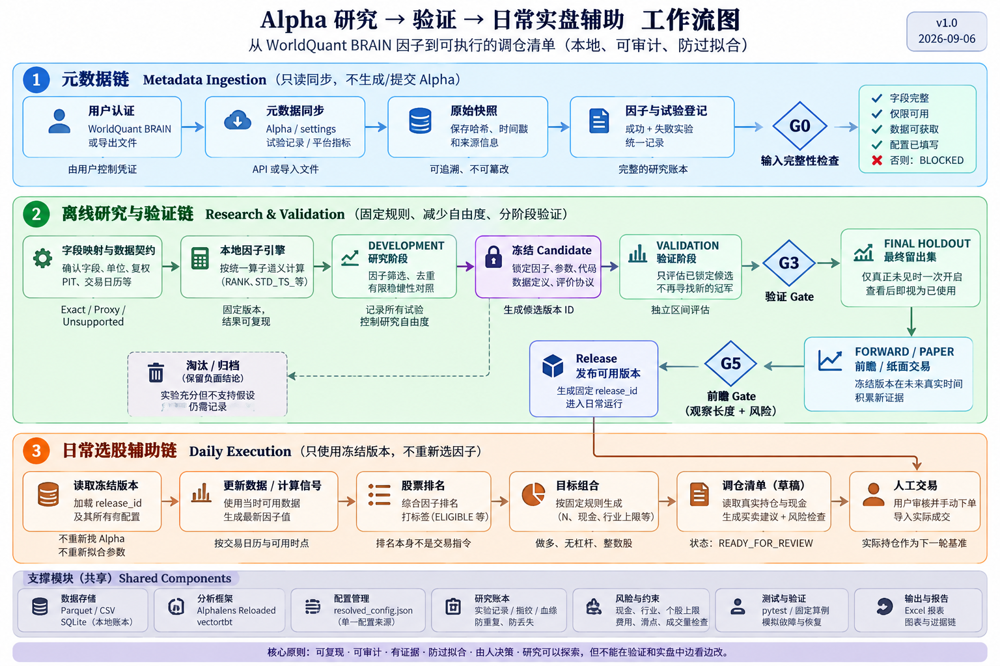
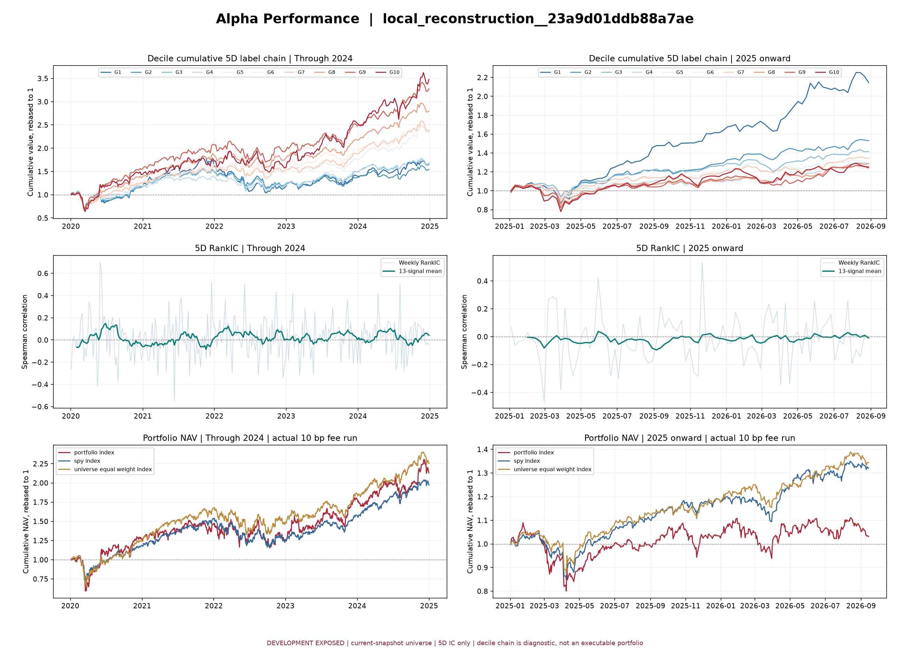

# Personal Alpha 135

把 WorldQuant BRAIN 中 Alpha 的经济假设整理为个人美股因子库，并用本地数据计算、检查和展示单因子表现。项目的核心是**可持续扩充的因子库**；选股与回测是检验和使用因子的轻量流程，最终交易由人决定。

> **当前状态（2026-11）**：V4 基础库有 135 个去重后的 `COMPUTE_VERIFIED` 本地公式，但全部仍是 `DIAGNOSTIC_ONLY`。历史样本可运行因子诊断、筛选和选股演示；尚未取得正式策略发布所需的 PIT 股票池、独立前瞻证据和完整执行成本验证。基本面扩库路线已冻结，当前可用基线仍是这 135 个公式。



## 从来源到选股的流程

| 阶段 | 输入与处理 | 输出 |
|---|---|---|
| 1. BRAIN 来源登记 | 保存原始表达式、设置、字段、来源 ID 与经济假设 | 可追溯的 Source Registry；886 个来源已审查 |
| 2. 本地重建 | 按可获得的数据字段重建直接公式或明确标注的假设代理；保留原始定义与信息损失 | 317 个来源关联到 135 个去重本地公式；569 个来源暂缓 |
| 3. 计算验证 | 统一字段适配、确定性计算、前缀不变性与哈希校验 | V4 因子库；`COMPUTE_VERIFIED` 表示能计算，不表示有预测能力 |
| 4. 按需筛选 | 仅在重新审查 Active Pool 时运行 V5.1 Lite Filter；使用固定的周度信号、5 日标签和预设 Gate | 因子诊断、冗余提示和待人工审查的候选池 |
| 5. 个人选股 | 对已选因子做横截面排名、等权合成；按当前流动性股票池生成排名 | Top 10% 等权目标持仓；手工调仓草稿是可选辅助，不会自动下单 |
| 6. 绩效展示 | 对**本次请求的单个 Alpha**运行 Alphalens、vectorbt 及图表输出 | 分组曲线、RankIC、组合净值、基准、排名及可核对的 CSV/JSON |
| 7. 前瞻记录 | 冻结候选与配置后记录实际后续信号和结果 | Forward Paper 的设计与组件；尚未形成正式前瞻通过结论 |

V5.1 的主标签固定为 `t close 冻结信号 → t+1 open 进入 → t+6 open 退出`。单因子图表只展示**该次运行实际算出的指标**；不会为了填满图表补造其他预测期限或成本情景。详见 [V5.1 Lite 使用说明](docs/implementation/2026-09-16-v5-1-library-first-usage.md) 和 [可视化输出设计](docs/superpowers/specs/2026-11-05-alpha-performance-visual-output-design.md)。

## 单因子图表 Demo

下图是一次保存的工程样例：本地公式 `rank(-(close / open - 1))`，500 只**当前快照**美股，保存的 Yahoo 调整后历史数据，组合回测从 2020-01-06 至 2026-09-14。上排是 G1–G10 的 5 日前瞻收益链接曲线，中排是 5D RankIC，下排是含 10 bp 单边费用的 Top 10% 组合及两个基准。



[打开图表说明](outputs/single-factor-demo-20261105/performance_report.md) · [股票排名](outputs/single-factor-demo-20261105/stock_ranking.csv) · [目标持仓](outputs/single-factor-demo-20261105/target_portfolio.csv) · [Alphalens 诊断](outputs/single-factor-demo-20261105/alphalens/summary.json) · [vectorbt 回测](outputs/single-factor-demo-20261105/vectorbt/summary.json) · [运行证据与限制](outputs/single-factor-demo-20261105/run_summary.json)

**读图边界**：分组曲线是周度信号的 5D 标签逐期链接，短交易周可能重叠，不能视为可执行的十组组合。该股票池用当前名单倒推历史，存在存活偏差；2019–2026 数据已用于开发，2025 年后的展示也不是独立 OOS。开盘成交、10 bp 费用及零滑点是简化假设。样例展示工作流与输出格式，不是因子有效性证明或交易建议。

以后每次给出单个 Alpha performance 时，使用同一[报告生成器](src/us_equity_alpha/performance_visual.py)在该次运行目录产出 `performance_report.png` 和 `performance_report.md`；原始 Alphalens/vectorbt 数据仍可逐项审查。生成器仅对符合[输入合同](docs/superpowers/specs/2026-11-05-alpha-performance-visual-output-design.md)的运行作图，缺少逐期分组收益时会标 `PARTIAL`，不会由分组均值伪造曲线。

## 当前证据与冻结边界

- **基础库**：V4 的 135 个公式及来源血缘由 SHA-256 锁定；[V4 验收说明](docs/implementation/2026-09-14-reconstruction-v4-final.md)和[冻结文件](config/alpha_library_freeze_v1.json)记录具体口径。原始 BRAIN 数据、个人公式库和行情样本保存在 Git 忽略的 `private/` 下，不随公开仓库分发。
- **历史筛选**：500 股 Yahoo 样本上的 V5.1 全历史运行曾形成 14 因子候选；只用 2019–2024 数据重新筛选得到 15 因子 `PRE2025_POOL`，再对 2025–2026 做一次历史回放。由于后段此前已暴露，该回放明确是 `RETROSPECTIVE_HOLDOUT_REPLAY`，不是独立 OOS，也没有改变冻结 Gate。[回放报告](outputs/v5-1-pre2025-holdout-replay-20260917/HISTORICAL_HOLDOUT_REPLAY_REPORT.md)
- **基本面扩库**：SEC PIT 数据管线及严格来源／假设代理双轨仍作为后续路线；最近一次扩充诊断没有新增经过计算验证的唯一公式，不能把财报字段覆盖等同于因子已纳入库。[暂停与恢复边界](docs/project-freezes/2026-09-23-alpha-library-and-fundamental-expansion-freeze.md)
- **执行**：排名与目标持仓供人工审核；可选手动调仓 helper 不提交订单。正式模拟盘或实盘仍需 PIT 股票池、公司行动、真实成本与前瞻证据等门禁。

## 仓库结构与本地使用

```text
src/us_equity_alpha/       因子解析、数据适配、筛选、选股、回测与报告代码
data_pipelines/sec_edgar/ 独立的 SEC 基本面 PIT 数据管线
config/                    冻结策略与因子库口径
docs/                      设计、实施说明和证据边界
outputs/                   可公开审查的样例图表与历史诊断报告
tests/                     工程验证
private/                   本地来源库、行情和运行证据；Git 忽略
```

项目使用 Python 3.12。取得依赖后可运行测试；样例的**重新计算**还需要仓库未分发的本地数据快照。

```bash
python3.12 -m venv .venv
.venv/bin/python -m pip install -r dependency-lock.txt
.venv/bin/python -m pip install --no-build-isolation --no-deps -e .
.venv/bin/python -m pytest -q --ignore=tests/test_history_verification.py
```

对符合单因子输出合同的运行目录，可单独重画最终报告：

```bash
.venv/bin/alpha-performance-report --run-dir path/to/one-alpha-run
```

凭证仅在本机输入或通过运行时环境提供，不应写入脚本、README、运行报告或 Git 历史。
