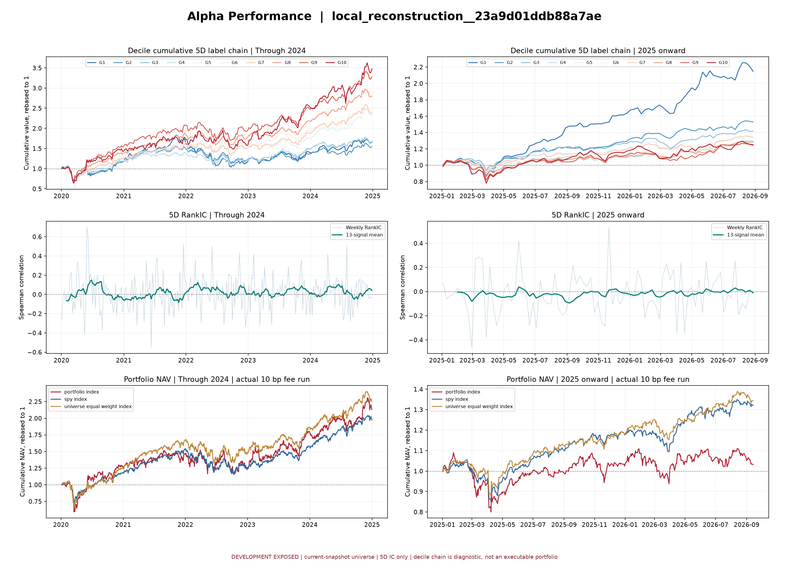

# Alpha Performance: local_reconstruction__23a9d01ddb88a7ae

公式：`rank(-(close / open - 1))`。图表：

状态：**PASS**。可用 IC 标签：**5D RankIC**；实际组合成本：**10 bp 单边**。

G1 是低分组，G10 是高分组。分组曲线是周度信号的 5D 前瞻收益逐期链接的诊断图；短交易周可能发生标签重叠，不能解释为可执行分组组合净值。

两段曲线各自归一化到 1。该 Yahoo 当前快照样本存在存活偏差，全段均为已暴露开发数据，**不属于独立 OOS**。

| CAGR | Sharpe（零无风险利率） | 最大回撤 | 模拟费用 | 模拟订单 |

|---:|---:|---:|---:|---:|

| 12.50% | 0.56 | -42.89% | $92,405.63 | 32,141 |
